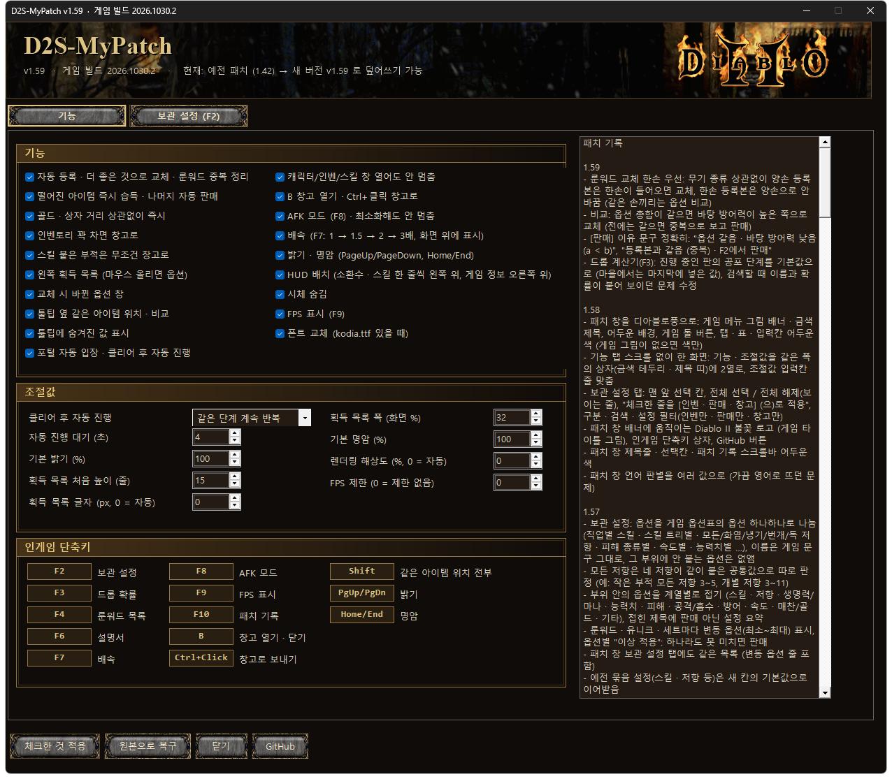
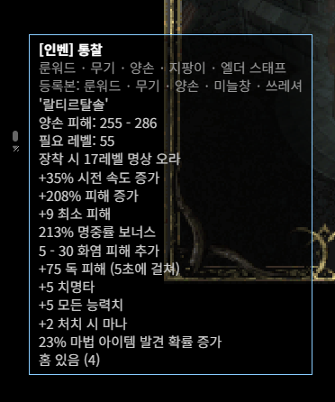
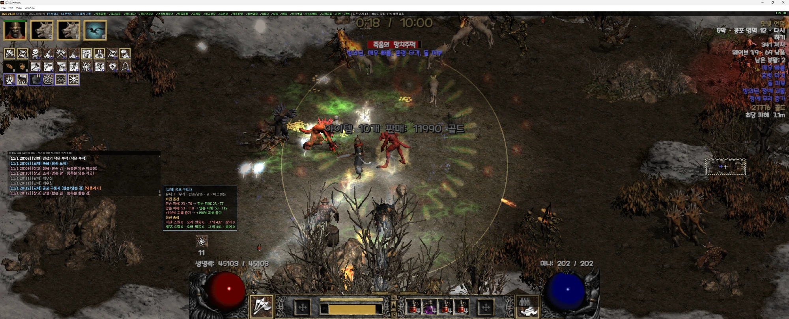
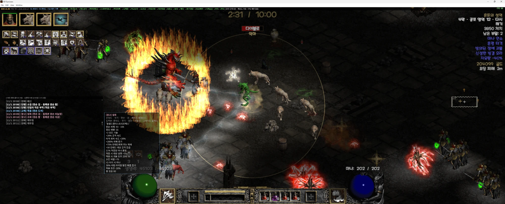
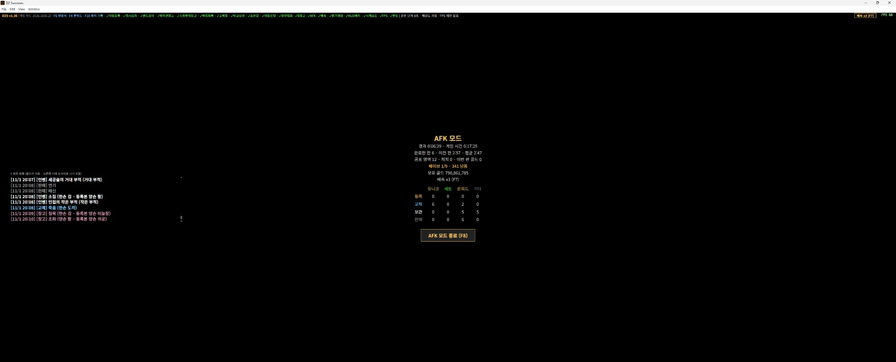
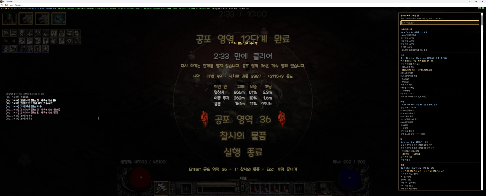
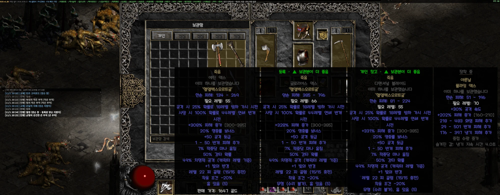
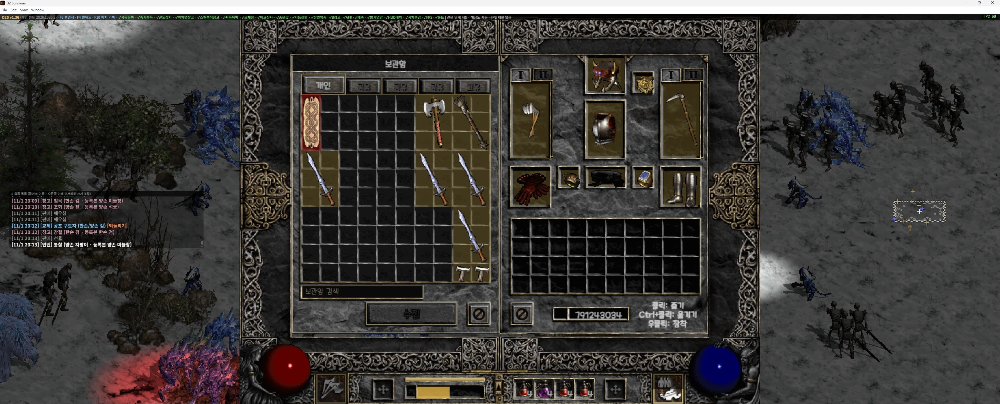
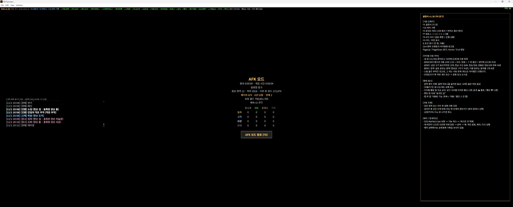
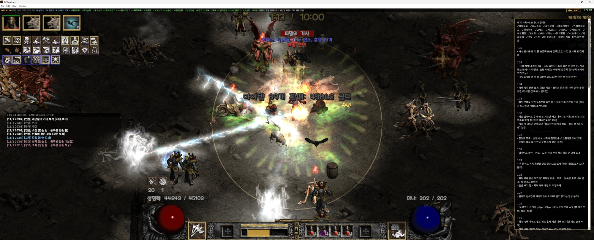

# D2 Survivors QoL Patch (D2S-MyPatch)

[한국어](README.md) | **English**

**Current patch: v1.57 · for game build 2026.1101.1** (previous build 2026.1030.2 also works)

<!-- notes -->
### Latest changes v1.57
- 보관 설정: 옵션을 게임 옵션표의 옵션 하나하나로 나눔 (직업별 스킬 · 스킬 트리별 · 모든/화염/냉기/번개/독 저항 · 피해 종류별 · 속도별 · 능력치별 …), 이름은 게임 문구 그대로, 그 부위에 안 붙는 옵션은 없앰
- 모든 저항은 네 저항이 같이 붙은 공통값으로 따로 판정 (예: 작은 부적 모든 저항 3~5, 개별 저항 3~11)
- 부위 안의 옵션을 계열별로 접기 (스킬 · 저항 · 생명력/마나 · 능력치 · 피해 · 공격/흡수 · 방어 · 속도 · 매찬/골드 · 기타), 접힌 제목에 판매 아닌 설정 요약
- 룬워드 · 유니크 · 세트마다 변동 옵션(최소~최대) 표시, 옵션별 "이상 적용": 하나라도 못 미치면 판매
- 패치 창 보관 설정 탭에도 같은 목록 (변동 옵션 줄 포함)
- 예전 묶음 설정(스킬 · 저항 등)은 새 칸의 기본값으로 이어받음

Earlier changes (expand)

**v1.56**
- 보관 설정(F2 · 패치 창 탭): 옵션마다 그 부위에 붙을 수 있는 수치 범위 표시 (게임 옵션표 기준, 예: 작은 부적 저항 3~11), 그 부위에 안 붙는 옵션 줄은 숨김

**v1.55**
- 패치 창 아래가 잘려 "체크한 것 적용" 버튼이 안 보이던 문제 수정 (버튼을 탭 밖 맨 아래로, 탭 안은 넘치면 스크롤)

**v1.54**
- 패치 창에 "보관 설정 (F2)" 탭: 게임의 F2 와 같은 설정을 표로 편집 (분류 · 검색 · 미등록만 · 보이는 줄 전부 바꾸기, 보이는 줄 상태 요약). 바꾸면 바로 저장되고 게임이 켜져 있으면 몇 초 안에 반영
- 게임 F2 와 패치 창이 같은 설정 파일(%APPDATA%\D2S-MyPatch\keep.json)을 씀
- F2 묶음 제목에 현재 상태 표시 (전부 판매 / 인벤 n · 창고 n · 판매 n), 누르면 가장 많은 것 말고 나머지 목록

**v1.53**
- 보관 설정(F2): 글씨 조금 크게, 매직을 레어 위로, 최소 수치 칸에 "이상 적용" 표시

**v1.52**
- 게임 아이템 필터(숨김 · 줍기 · 판매 · 보관)를 완전히 무시하고 F2 보관 설정만 따름 (숨김으로 둔 아이템도 주워서 F2대로 처리)

<!-- /notes -->

An unofficial quality-of-life patch that makes farming in D2 Survivors much easier.
A **single bat file** handles feature selection, patching, restoring the original, and auto-updates.
The patch UI follows your Windows language (Korean / English).

> ⚠ While patched, your runs are **not sent to the leaderboard**. Restore the original before playing for the leaderboard.
> This is an unofficial patch. Back up your save (`%APPDATA%\D2 Survivors\save`) before first use.

## Download / Install

1. **[Download D2S-MyPatch.bat](https://github.com/mastree-master/D2S-MyPatch/raw/main/D2S-MyPatch.bat)** (save it anywhere and keep it there)
2. Close the game and run the bat → if "Windows protected your PC" appears, click **More info → Run anyway**
3. Check the features you want → **Apply checked** → start the game

To undo: run the bat → **Restore original**.

## Auto-update

When a new version is released, a notice appears at the bottom right of the game. Click it → **Yes**: the game closes, the patcher opens, and the game restarts after applying.
If the game itself updates, the patch is removed automatically. Run the bat again and it **re-applies only what still works** on the new game version and tells you what doesn't.

## Main features

Top bar (version · enabled features · speed · FPS), HUD layout top-left, run info top-right, pickup log and upgrade popup

### Automatic item handling
- Items, gold and chests are picked up instantly at any distance
- New uniques / sets / runewords are **auto-stashed**; better copies **auto-upgrade** (skills > aura/proc > other stats > defense)
- Runewords only upgrade within the same weapon type, one-handed preferred, duplicates sorted per type
- Charms with skills go to the stash, everything else is auto-sold
- When the inventory is full, items go to the stash

### Pickup log (chat style)
- Time · stashed / upgraded / bag / stash / sold, scroll back with the mouse wheel
- Hover a line for item stats (game colors); upgrades show **only changed stats, old (red) → new (green)**
- Unique/set upgrades can be undone
- Drag to move, resize from the corner

### AFK mode (F8)
Black screen showing only elapsed time · game time · runs · wave · gold · stashed/upgraded/kept/sold counts. Keeps running when minimized.

### Runeword list (F4)
Every runeword read from the game data: runes · level · item types, **fixed stats (grey) / variable stats min~max (yellow)**, search.

### More
- Auto-enter portal; after a clear, repeat the same tier or go up one tier
- Game speed 1 / 1.5 / 2 / 3x (F7)
- Character / inventory / skill panels don't pause the game, B opens the stash, Ctrl+click sends to stash
- Compare boxes next to tooltips show where copies are; hidden values shown. Hold **Shift** to list every copy (stash / personal / shared tabs / inventory)
- Brightness / contrast (PageUp·PageDown / Home·End), hide corpses, render resolution, FPS display (F9) and cap
- HUD layout: pets and skills one row each top-left, run info top-right
- Top bar shows version · game build · enabled features (✓/✗)

### Compare boxes · Stash

### Guide (F6) · Patch log (F10)

## Hotkeys

| Key | Action |
|---|---|
| F6 | Guide |
| F4 | Runeword list |
| F3 | Drop chance calculator |
| F2 | Keep settings (sell / bag / stash per item, registered count) |
| F10 | Patch log |
| F7 | Game speed |
| F8 | AFK mode |
| F9 | FPS display |
| Shift (over an item) | Show every copy |
| B | Stash |
| Ctrl+click | Send inventory item to stash |
| PageUp / PageDown | Brightness |
| Home / End | Contrast |

## Font (optional)
Put `kodia.ttf` next to the bat and patch to replace the game font with it. (Font not included.)

## Notes
- Game numbers (damage, gold, stats) are not changed. Game speed only makes runs go faster.
- Screenshots show the Korean UI.
