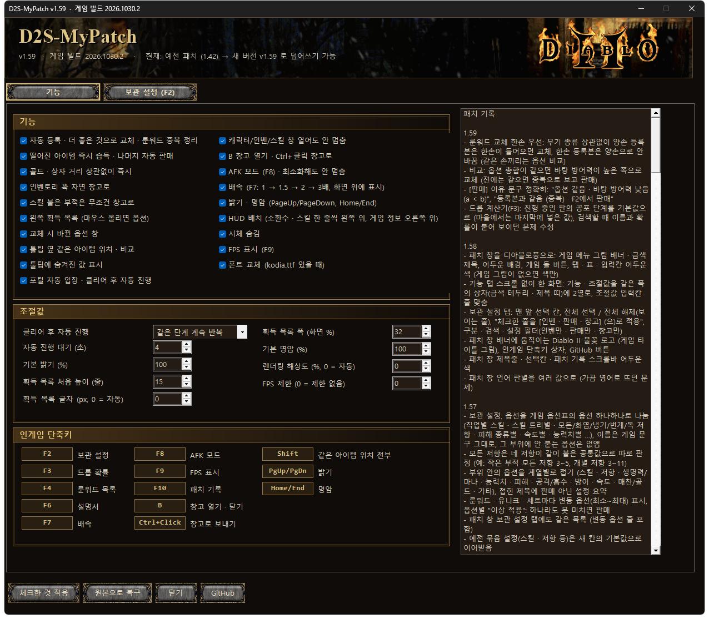
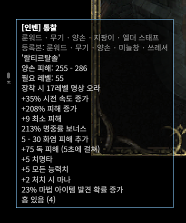
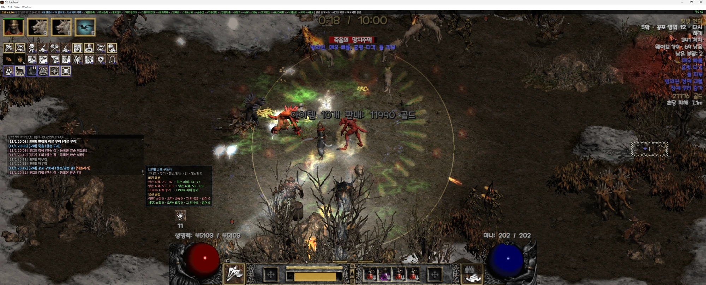
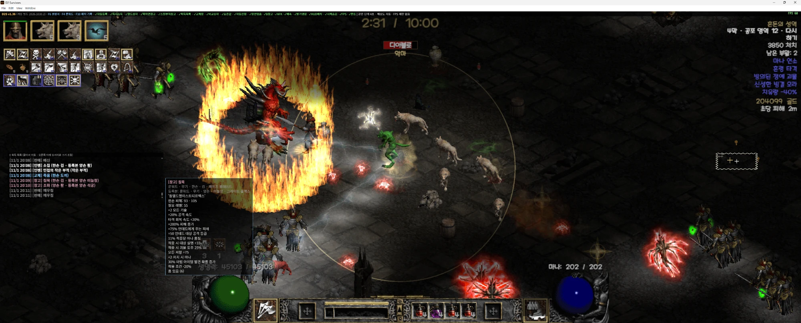
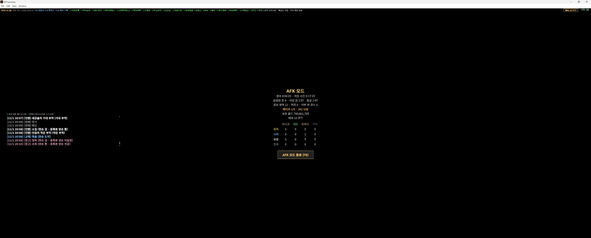
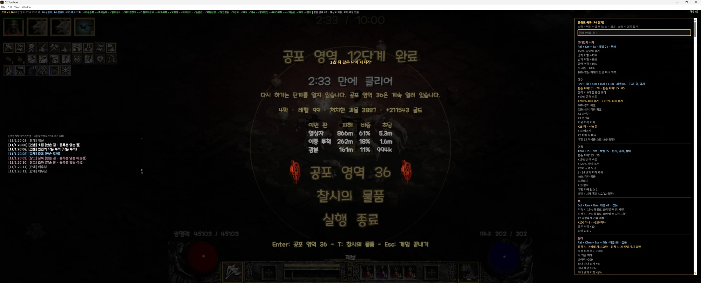
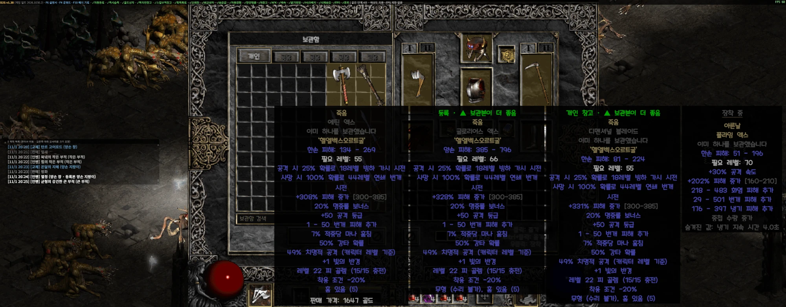
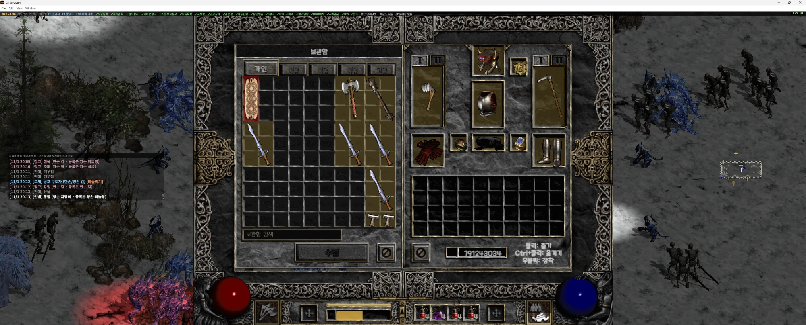
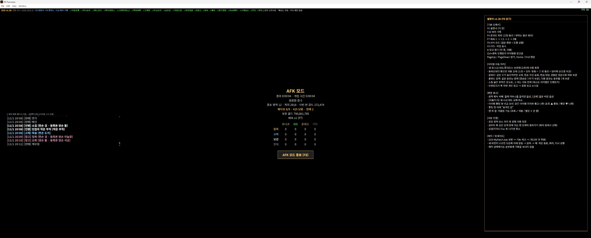
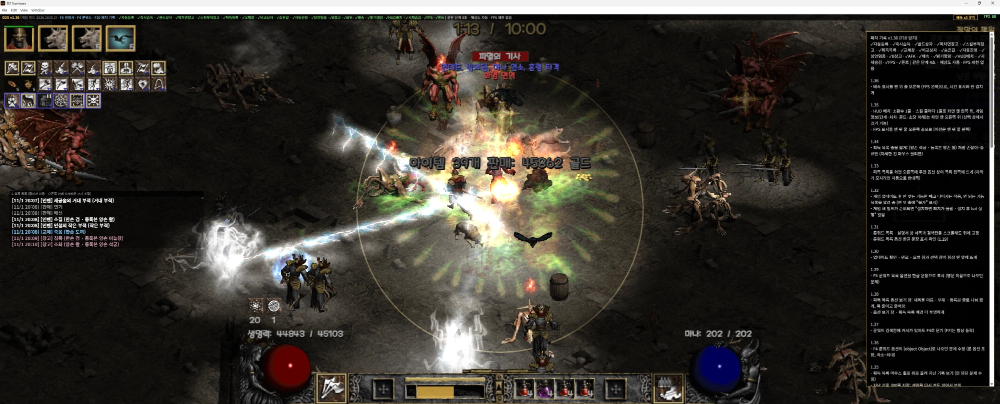

# D2 Survivors 편의 패치 (D2S-MyPatch)

**한국어** | [English](README.en.md)

**현재 패치 버전: v1.59 · 게임 빌드 2026.1101.1 대응** (이전 빌드 2026.1030.2도 가능)

<!-- notes -->
### 최근 패치 내용 v1.59
- 비교: 옵션 총합이 같으면 바탕 방어력이 높은 쪽으로 교체 (전에는 같으면 중복으로 보고 판매)
- [판매] 이유 문구 정확히: "옵션 같음 · 바탕 방어력 낮음 (a < b)", "등록본과 같음 (중복) · F2에서 판매"
- 드롭 계산기(F3): 진행 중인 판의 공포 단계를 기본값으로 (마을에서는 마지막에 넣은 값), 검색할 때 이름과 확률이 붙어 보이던 문제 수정

이전 패치 내용 (펼치기)

**v1.58**
- 패치 창을 디아블로풍으로: 게임 메뉴 그림 배너 · 금색 제목, 어두운 배경, 게임 돌 버튼, 탭 · 표 · 입력칸 어두운 색 (게임 그림이 없으면 색만)
- 기능 탭 스크롤 없이 한 화면: 기능 · 조절값을 같은 폭의 상자(금색 테두리 · 제목 띠)에 2열로, 조절값 입력칸 줄 맞춤
- 보관 설정 탭: 맨 앞 선택 칸, 전체 선택 / 전체 해제(보이는 줄), "체크한 줄을 [인벤 · 판매 · 창고] (으)로 적용", 구분 · 검색 · 설정 필터(인벤만 · 판매만 · 창고만)
- 패치 창 배너에 움직이는 Diablo II 불꽃 로고 (게임 타이틀 그림), 인게임 단축키 상자, GitHub 버튼
- 패치 창 제목줄 · 선택칸 · 패치 기록 스크롤바 어두운 색
- 패치 창 언어 판별을 여러 값으로 (가끔 영어로 뜨던 문제)

**v1.57**
- 보관 설정: 옵션을 게임 옵션표의 옵션 하나하나로 나눔 (직업별 스킬 · 스킬 트리별 · 모든/화염/냉기/번개/독 저항 · 피해 종류별 · 속도별 · 능력치별 …), 이름은 게임 문구 그대로, 그 부위에 안 붙는 옵션은 없앰
- 모든 저항은 네 저항이 같이 붙은 공통값으로 따로 판정 (예: 작은 부적 모든 저항 3~5, 개별 저항 3~11)
- 부위 안의 옵션을 계열별로 접기 (스킬 · 저항 · 생명력/마나 · 능력치 · 피해 · 공격/흡수 · 방어 · 속도 · 매찬/골드 · 기타), 접힌 제목에 판매 아닌 설정 요약
- 룬워드 · 유니크 · 세트마다 변동 옵션(최소~최대) 표시, 옵션별 "이상 적용": 하나라도 못 미치면 판매
- 패치 창 보관 설정 탭에도 같은 목록 (변동 옵션 줄 포함)
- 예전 묶음 설정(스킬 · 저항 등)은 새 칸의 기본값으로 이어받음
- F2 검색: 아이템 이름(한글 · 영어), 옵션 줄, 룬워드 · 유니크 · 세트의 변동 옵션 줄까지 찾고, 찾은 것이 있는 묶음만 펼침 (띄어쓰기 무시: 공격속도 = 공격 속도, 패치 창 탭도 같음)
- 보관 설정에 "기타 › 호라드림의 고서" 추가 (판매 / 인벤 / 창고, 기본 판매)
- 보관 설정 "기타"에 퀘스트 아이템 9종 (기술 책 · 람 에센의 고서 · 생명력 물약 · 저항의 두루마리 · 면죄의 징표 · 호라드림 망치 · 호라드림의 두루마리 · 이니푸스의 두루마리 · 돌무덤 열쇠): 인벤 / 창고 (팔 수 없어 판매는 인벤으로)
- 유니크 부적(기드의 행운 등)은 "부적 › 유니크 부적"으로 옮김 (부적 바탕 유니크는 자동으로 여기에)

**v1.56**
- 보관 설정(F2 · 패치 창 탭): 옵션마다 그 부위에 붙을 수 있는 수치 범위 표시 (게임 옵션표 기준, 예: 작은 부적 저항 3~11), 그 부위에 안 붙는 옵션 줄은 숨김

**v1.55**
- 패치 창 아래가 잘려 "체크한 것 적용" 버튼이 안 보이던 문제 수정 (버튼을 탭 밖 맨 아래로, 탭 안은 넘치면 스크롤)

**v1.54**
- 패치 창에 "보관 설정 (F2)" 탭: 게임의 F2 와 같은 설정을 표로 편집 (분류 · 검색 · 미등록만 · 보이는 줄 전부 바꾸기, 보이는 줄 상태 요약). 바꾸면 바로 저장되고 게임이 켜져 있으면 몇 초 안에 반영
- 게임 F2 와 패치 창이 같은 설정 파일(%APPDATA%\D2S-MyPatch\keep.json)을 씀
- F2 묶음 제목에 현재 상태 표시 (전부 판매 / 인벤 n · 창고 n · 판매 n), 누르면 가장 많은 것 말고 나머지 목록

<!-- /notes -->

D2 Survivors를 편하게 파밍할 수 있게 해 주는 비공식 패치입니다.
**bat 파일 하나**로 기능 선택, 패치, 원본 복구, 자동 업데이트를 모두 처리합니다.

> ⚠ 패치 상태에서는 순위표(래더)에 기록이 **올라가지 않습니다**. 순위표용 플레이는 원본으로 복구한 뒤 하세요.
> 비공식 패치입니다. 처음 쓰기 전에 세이브(`%APPDATA%\D2 Survivors\save`)를 백업해 두는 걸 권장합니다.

## 받기 / 설치

1. **[D2S-MyPatch.bat 받기](https://github.com/mastree-master/D2S-MyPatch/raw/main/D2S-MyPatch.bat)** (아무 폴더에 저장, 나중에 옮기지 않기)
2. 게임을 끄고 bat 실행 → "Windows의 PC 보호"가 뜨면 **[추가 정보] → [실행]**
3. 원하는 기능만 체크 → **[체크한 것 적용]** → 게임 실행

원래대로 돌리려면 bat 실행 → **[원본으로 복구]**.

## 자동 업데이트

새 버전이 올라오면 게임 오른쪽 아래에 알림이 뜹니다. 클릭 → **예** 를 누르면 게임이 꺼지고, 패치 창이 열리고, 적용하면 게임이 다시 켜집니다.
게임 자체가 업데이트되면 패치가 풀립니다. bat를 다시 실행하면 새 게임 버전에서 **되는 기능만 적용**하고 안 되는 기능을 알려 줍니다.

## 주요 기능

맨 위 줄(버전 · 적용 기능 · 배속 · FPS), 왼쪽 위 HUD 배치, 오른쪽 위 게임 정보, 획득 목록과 교체 창

### 아이템 자동 처리
- 떨어진 아이템 · 골드 · 상자를 거리 상관없이 즉시 처리
- 새 유니크 / 세트 / 룬워드는 보관함에 **자동 등록**, 더 좋은 게 나오면 **자동 교체** (스킬 > 오라·발동 > 그 외 옵션 > 방어력 순)
- 룬워드는 같은 무기 종류끼리만 교체, 한손 우선 등록, 중복은 종류별로 정리
- 스킬 붙은 부적은 창고로, 나머지는 자동 판매
- 인벤토리가 꽉 차면 창고로

### 획득 목록 (채팅창처럼)
- 시간 · 등록 / 교체 / 인벤 / 창고 / 판매 표시, 마우스 휠로 지난 기록 보기
- 줄에 마우스를 올리면 옵션, 교체는 **바뀐 옵션만 이전(빨강) → 새것(초록)**
- 유니크·세트 교체는 [되돌리기] 가능
- 창을 끌어서 이동, 모서리로 크기 조절

### AFK 모드 (F8)
화면을 검게 덮고 경과 시간 · 게임 시간 · 판 수 · 웨이브 · 골드 · 등록/교체/보관/판매 개수만 표시. 창을 내려도 멈추지 않습니다.

### 룬워드 목록 (F4)
게임 데이터에서 읽은 모든 룬워드의 룬 조합 · 레벨 · 들어가는 장비, **고정 옵션(회색) / 변하는 옵션 최소~최대(노랑)**, 검색.

### 그 밖에
- 포털 자동 입장, 클리어 후 같은 단계 반복 또는 한 단계씩 올라가기
- 배속 1 / 1.5 / 2 / 3배 (F7)
- 캐릭터 · 인벤 · 스킬 창을 열어도 게임이 멈추지 않음, B 키로 창고, Ctrl+클릭으로 창고 보내기
- 툴팁 옆 같은 아이템 위치·비교, 숨겨진 값 표시. **Shift** 를 누르면 같은 이름 아이템이 어디 있는지 전부 (등록 / 개인 창고 / 공용 창고 / 인벤)
- 밝기 / 명암 (PageUp·PageDown / Home·End), 시체 숨김, 렌더링 해상도, FPS 표시(F9) · 제한
- HUD 배치: 소환수 · 스킬 한 줄씩 왼쪽 위, 게임 정보 오른쪽 위
- 맨 위 줄에 버전 · 게임 빌드 · 적용 기능(✓/✗) 표시

### 비교 상자 · 창고

### 설명서 (F6) · 패치 기록 (F10)

## 단축키

| 키 | 기능 |
|---|---|
| F6 | 설명서 |
| F4 | 룬워드 목록 |
| F3 | 드롭 확률 계산기 |
| F2 | 보관 설정 (아이템별 판매 / 인벤 / 창고, 등록 개수) |
| F10 | 패치 기록 |
| F7 | 배속 |
| F8 | AFK 모드 |
| F9 | FPS 표시 |
| Shift (아이템 위에서) | 같은 아이템 위치 전부 |
| B | 창고 |
| Ctrl+클릭 | 인벤토리 아이템 창고로 |
| PageUp / PageDown | 밝기 |
| Home / End | 명암 |

## 폰트 (선택)
bat와 같은 폴더에 `kodia.ttf` 를 넣고 패치하면 게임 글꼴을 그 폰트로 바꿉니다. (폰트 파일은 포함하지 않습니다)
